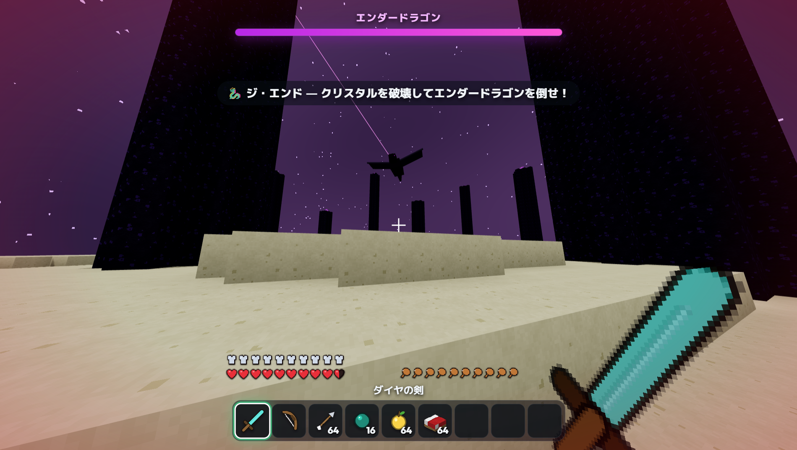
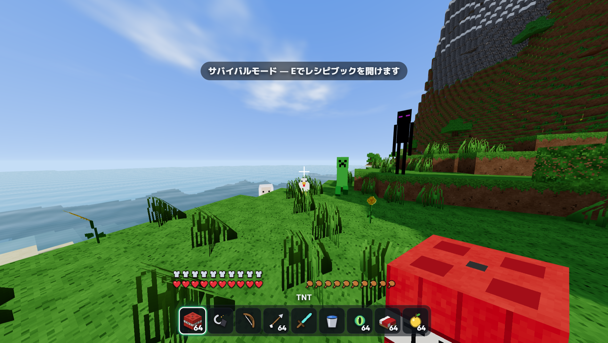
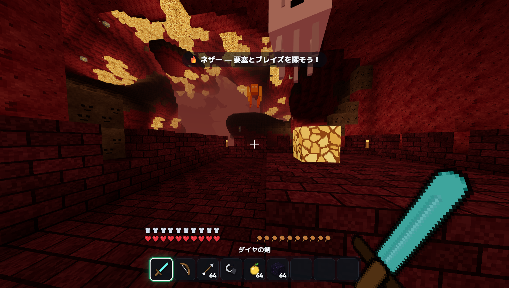
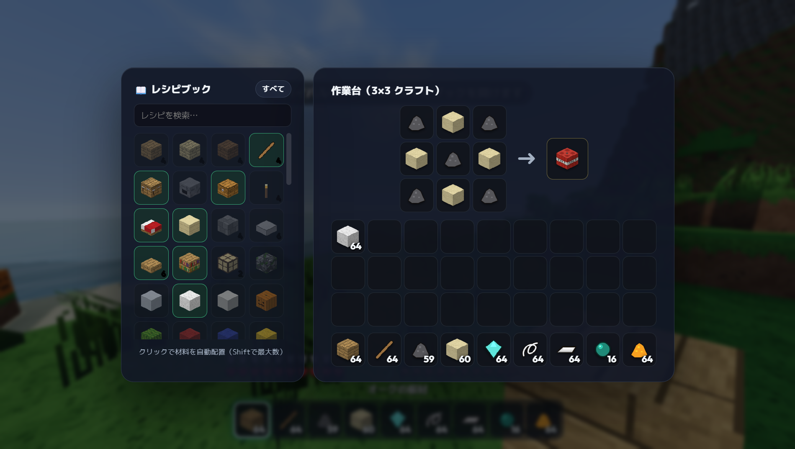
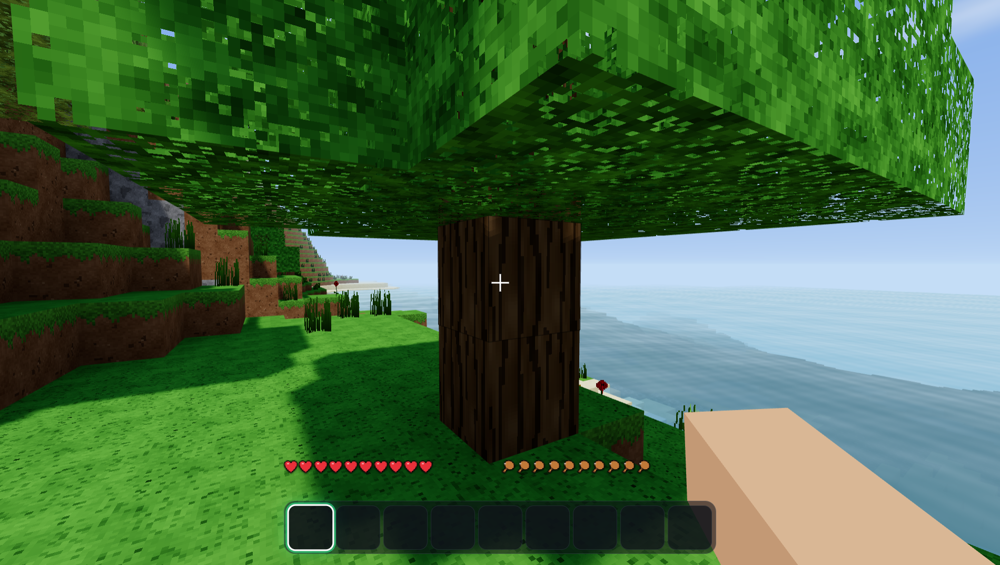
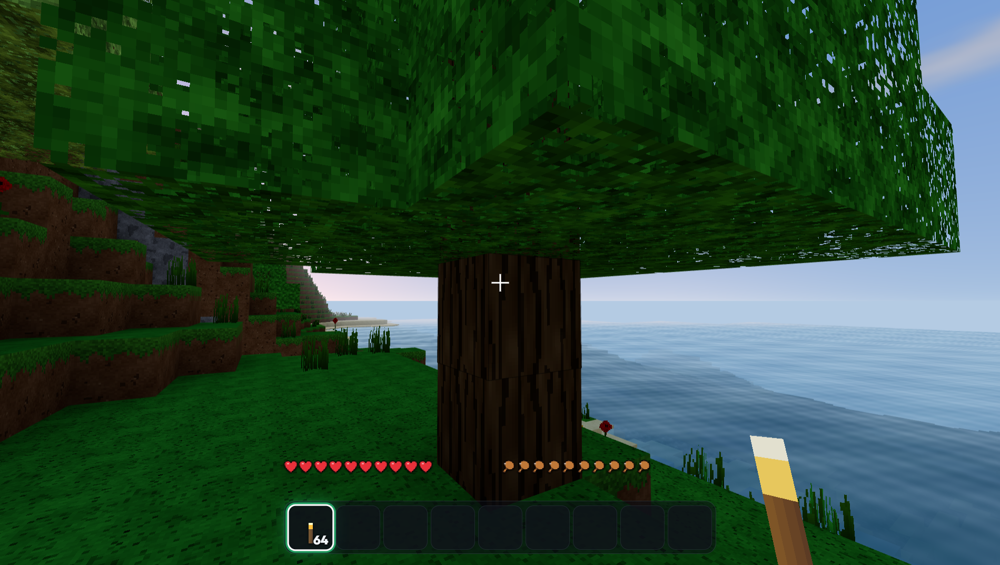

# 🌍 InfiniCraft v2.0.0

**無限に広がるオーバーワールド・ネザー・ジ・エンドを冒険する、本格3Dボクセルサンドボックスゲーム。**  
サバイバルとクリエイティブの両モードに対応し、13種類のモブ＆エンダードラゴン討伐、TNT・弓矢・防具・農業、ワンクリック自動配置つきレシピブック、動物・モンスター・爆発のリアルタイム合成サウンドを完備した Windows デスクトップアプリ（`.exe`）です。



| オーバーワールド＆モブ・装備 | ネザー要塞＆ブレイズ・ガスト | レシピブック＆ワンクリッククラフト |
|---|---|---|
|  |  |  |

| リアルタイムの影と水面 | 夕暮れと松明の光源 |
|---|---|
|  |  |

> オリジナル作品です。Mojang / Microsoft の「Minecraft」とは関係ありません。テクスチャ・3Dモデル・効果音はすべてプログラムでプロシージャル生成しており、外部素材は一切使用していません。

---

## ⬇️ ダウンロード（Windows 64-bit）

[**最新リリース (v2.0.0)**](../../releases/latest) から次のどちらかをダウンロードしてすぐに遊べます。

| ファイル | 説明 |
|---|---|
| `InfiniCraft-Setup-2.0.0.exe` | **インストーラー版**（スタートメニューとデスクトップにショートカットを作成） |
| `InfiniCraft-2.0.0-portable.exe` | **ポータブル版**（インストール不要。ダブルクリックですぐ起動） |

> 💡 Windows SmartScreen の保護画面が表示された場合は **「詳細情報」→「実行」** を押してください（個人開発の未署名バイナリのため表示されます）。

---

## 🆕 v2.0.0 大型アップデート内容

1. **🏃 本格ダッシュ（Wキー2回押し ＆ Ctrlラッチ）**
   - `W` 素早く2回押し、または `Ctrl + W` でダッシュ開始！`W` を押し続けている間はダッシュが維持され、視野角（FOV）もダイナミックに広がります。
2. **🐾 全13種類のモブ ＆ ボス「エンダードラゴン」**
   - **動物（4種）**：豚・牛（革＆牛肉）・羊（色付き羊毛＆羊肉）・鶏（羽根＆鶏肉、滑空落下）
   - **オーバーワールドのモンスター（5種）**：ゾンビ・スケルトン（弓で矢を発射）・クリーパー（シューッと膨張点滅してブロックごと爆破）・クモ（壁登り＆飛びかかり）・エンダーマン（目が合うと敵対、矢をテレポート回避、水でダメージ）
   - **ネザーのモブ（3種）**：ピグリン（金の剣装備・集団反撃）・ガスト（空中浮遊＆打ち返し可能な爆発火球）・ブレイズ（ネザー要塞周辺に出現＆3連火球バースト）
   - **ジ・エンドのボス**：**エンダードラゴン**（HP 200、専用ボスHPバー、黒曜石の柱上の10個の**エンドクリスタル**から回復ビーム、旋回・急降下・中央の泉への着地フェーズ、討伐時に帰還ポータル開通＆**ドラゴンの卵**出現）
   - **クリエイティブでの適正ダメージ**：クリエイティブでも素手ワンパンにならず、素手は1ダメージ・ダイヤの剣は8ダメージなど武器本来の攻撃力でモブと戦えます。
3. **🧨 TNT・弓矢・バケツ・防具・ベッド・チェスト・農業（80種以上のブロック＆アイテム）**
   - **TNT**：火打石と打ち金（またはブレイズパウダー・松明）で着火！重力で跳ね、点滅・膨張して大爆発＆周囲のTNTへ誘爆。
   - **弓と矢**：右クリック長押しで引き絞り（チャージバー表示）、放物線を描く3Dの矢を発射。
   - **バケツ・水・溶岩**：水源・溶岩源の汲み取りと設置。水と溶岩が触れると**黒曜石**を生成！
   - **4部位の防具**：革・鉄・金・ダイヤのヘルメット／チェストプレート／レギンス／ブーツ（最大80%ダメージ軽減、HUD防御バー表示、右クリックで即装備）。
   - **チェスト・ベッド・農業**：27スロット永続保存の**チェスト**、夜をスキップしてリスポーン地点を設定する**ベッド**（ネザー／エンドで使うと爆発！）、**クワ**で耕す畑と小麦栽培・苗木の植林・**骨粉**による急成長、**金のリンゴ**（再生効果）、**エンダーパール**（投擲テレポート）、ハーフブロックや色付き羊毛など多数追加。
4. **📖 レシピブック付きクラフトUI（全87レシピ）**
   - インベントリ（2×2）と作業台（3×3）の横に **「📖 レシピブック」** を常設！検索・「作れるのみ」フィルタ・材料ツールチップに対応。
   - **ワンクリック自動配置**（`Shift+クリック` で最大数配置）や、右クリックドラッグによる均等配置に対応。クリエイティブでも「⚒ クラフト・装備」タブから自由にクラフト＆防具装着が可能。
5. **🔊 動物・モンスター・爆発のリアルタイム合成効果音**
   - 牛のモー声、羊のメェ声、鶏のコケッ声、豚のブヒ声、ゾンビの唸り、スケルトンの骨音、クリーパーの導火線音、エンダーマン・ガスト・ブレイズ・エンダードラゴンの咆哮と羽ばたき、爆発音、弓の発射・命中音、ポータル音などを WebAudio でプロシージャル合成。
6. **🔥 ネザー ＆ 🐉 ジ・エンド（全3ディメンション完全実装）**
   - **ネザー**：黒曜石フレーム（4×5以上）に火打石と打ち金で着火して移動！ネザーラックの大空洞、ソウルサンドの谷、グロウストーン、ネザークォーツ鉱石、溶岩の海、そしてブレイズが待ち受ける**ネザー要塞**を生成。
   - **ジ・エンド**：**エンダーアイ**を投げてオーバーワールド地下の**要塞（Stronghold）**を探知し、12個のエンドポータルフレームすべてにエンダーアイをはめ込むと開通！浮遊するエンドストーンの島々と黒曜石の柱で最終決戦へ挑めます。

---

## 🕹️ 操作方法

| キー / マウス | 操作 |
|---|---|
| `W A S D` | 移動 |
| **`W` 2回押し** または **`Ctrl` + `W`** | **ダッシュ**（`W` 維持中は継続） |
| `Space` | ジャンプ / 泳ぐ / 2回押しで飛行切替（クリエイティブ） |
| `左Shift` | スニーク（ブロック端から落ちない） / 飛行中は下降 |
| `左クリック` | ブロック採掘 / モブ攻撃 / ガスト火球の打ち返し / クリスタル破壊 |
| `右クリック` | ブロック設置 / 弓を引く / 食事 / 着火 / 作業台・かまど・チェスト・ベッド使用 |
| `ホイール` / `1〜9` | ホットバー選択 |
| `E` | インベントリ・防具・レシピブックを開く |
| `Q` | 手持ちアイテムを捨てる（`Ctrl + Q` でスタックごと） |
| `中クリック` | 見ているブロックをスポイト取得（クリエイティブ） |
| `F3` | デバッグ情報（座標・ディメンション・バイオーム・FPS） |
| `F11` | フルスクリーン切替 |
| `Esc` | ポーズメニュー（モード切替・設定・セーブしてタイトルへ） |

### 🏆 エンダードラゴン討伐までのロードマップ（サバイバル）
1. **木と石の時代**：原木から作業台を作り、ツルハシで石・石炭・鉄鉱石を採掘。牛や羊から食料・革・羊毛を集めて**ベッド**と**防具**を整える。
2. **ダイヤと黒曜石**：地下深くで**ダイヤモンド**を掘り、ダイヤのツルハシ（または水バケツ＋溶岩）で**黒曜石**を集め、砂利から出た火打石＋鉄で**火打石と打ち金**を作る。
3. **ネザー遠征**：黒曜石で縦長フレームを組んで着火し**ネザー**へ！**ネザー要塞**を見つけて**ブレイズ**を倒し、**ブレイズロッド**を入手する。
4. **地下要塞の発見**：エンダーマンから集めた**エンダーパール**と**ブレイズパウダー**で**エンダーアイ**をクラフト。地上で右クリック投擲し、飛んでいく方向の地下にある**要塞のエンドポータル部屋**を見つける。
5. **最終決戦（ジ・エンド）**：12個のフレームにエンダーアイをはめてポータルを起動！弓矢や剣で柱の上の**エンドクリスタル**を破壊し、**エンダードラゴン**を討伐しよう！

---

## 🛠️ 開発・ビルド

```bash
npm install
npm run dev                        # ブラウザで開発起動 (http://localhost:5173)
npm run build && npx electron .    # Electron デスクトップアプリとして起動
npm run dist                       # Windows 用インストーラー & ポータブル .exe を release/ に出力
```

技術スタック：**Three.js**（WebGL2 / GLSL カスタムシェーダー） · **Web Workers** · **WebAudio API** · **Vite** · **Electron** · **electron-builder**

## 📄 ライセンス
MIT
