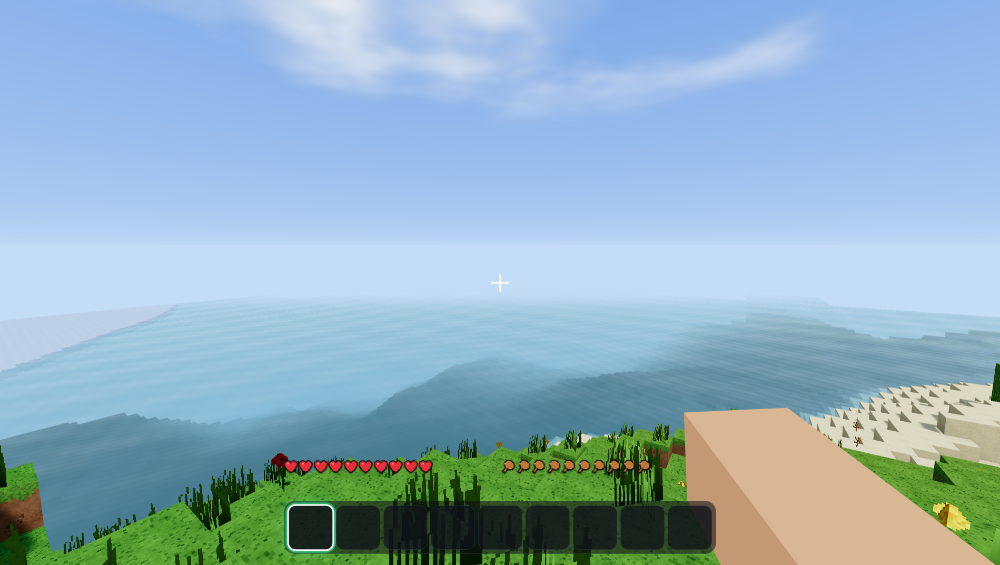
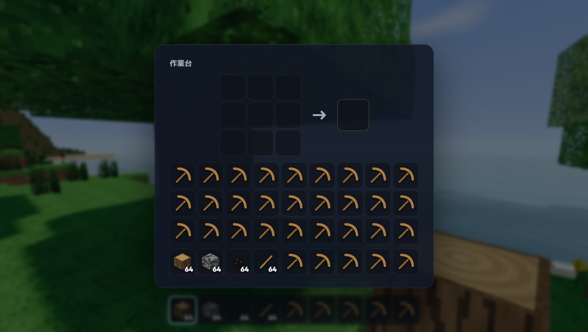

# 🌍 InfiniCraft

**無限に広がる、リアルなボクセルワールド。** サバイバルとクリエイティブを本格的に遊べる、Windows向けのサンドボックスゲームです。



| リアルタイムの影と水面 | 夕暮れと松明 | クラフト |
|---|---|---|
|  |  |  |

> オリジナル作品です。Mojang / Microsoft の「Minecraft」とは関係ありません。テクスチャや音はすべてプログラムで生成しているので、外部素材は使っていません。

## ⬇️ ダウンロード

[**Releases**](../../releases/latest) から次のどちらかをダウンロードしてください。

| ファイル | 説明 |
|---|---|
| `InfiniCraft-Setup-1.0.0.exe` | インストーラー版（スタートメニューとデスクトップにショートカットを作ります） |
| `InfiniCraft-1.0.0-portable.exe` | ポータブル版（インストール不要。ダブルクリックですぐ遊べます） |

> Windows SmartScreen の警告が出たら「詳細情報」→「実行」を押してください（署名していないアプリのため表示されます）。

## ✨ 特徴

### 🌍 無限ワールド
- プレイヤーの周りのチャンクを**どこまでも自動で生成**します。生成はマルチスレッド（Web Worker）で行います
- 地形の種類：海・砂浜・平原・森林・白樺の森・砂漠・サバンナ・タイガ・雪原・山岳・雪山・凍った海・川
- 大陸・侵食・尾根の3種類のノイズを組み合わせて、険しい山脈や渓谷を作ります
- スパゲッティ洞窟、大空洞、地下の溶岩湖
- 鉱石：石炭・鉄・金・ダイヤモンド
- 木：オーク・大きなオーク・白樺・トウヒ・アカシア。ほかにサボテン、草花、シダ
- **シード値**が同じなら同じ世界になります

### ✨ リアルなグラフィック
- 太陽と月が動く**昼夜サイクル**。空のグラデーション、夕焼け、星空、流れる雲
- 太陽光による**リアルタイムの影**
- **スムースライティング**と**アンビエントオクルージョン**。洞窟の中はちゃんと暗くなります
- **松明やランプの光**が周りに広がります
- 波打つ**水面**（反射とスペキュラー）と、水中のフォグ
- **風で揺れる葉や草**、バイオームごとに変わる草の色
- ACESトーンマッピング。ブロックを壊すと破片が飛び散ります

### 🎮 ゲームプレイ
- **サバイバル**：体力・空腹・酸素、落下ダメージ、溶岩
- **クリエイティブ**：全ブロック使い放題、飛行（スペースを2回押す）、ダメージなし
- 採掘時間はブロックの硬さと道具で変わり、ひび割れが表示されます
- **クラフト**（2×2と3×3、30種類以上のレシピ）、**かまど**で精錬・料理
- 道具：木・石・鉄・金・ダイヤのツルハシ・斧・シャベル・剣。耐久値があります
- **Mob**：昼は豚がうろつき、夜はゾンビが襲ってきます（日光で燃えます）
- ドロップしたアイテムは近づくと吸い寄せられて拾えます
- 効果音と環境音（風・鳥・水中の音）
- **自動セーブ**と複数ワールドの管理

## 🕹️ 操作方法

| キー | 操作 |
|---|---|
| W A S D | 移動 |
| マウス | 視点 |
| スペース | ジャンプ / 泳ぐ / 2回押しで飛行（クリエイティブ） |
| 左Ctrl | ダッシュ |
| 左Shift | スニーク（端から落ちない） / 飛行中は下降 |
| 左クリック | 壊す / 攻撃 |
| 右クリック | 置く / 食べる / 作業台・かまどを開く |
| ホイール, 1〜9 | アイテム選択 |
| E | インベントリ |
| Q | アイテムを捨てる（Ctrl+Qでスタックごと） |
| 中クリック | ブロックを選ぶ（クリエイティブ） |
| F3 | デバッグ情報 |
| F11 | フルスクリーン |
| Esc | ポーズ |

### はじめの一歩（サバイバル）
1. 木を素手で壊して**原木**を集める
2. E → 原木を置いて**板材**にする → 板材4つで**作業台**、板材2つで**棒**を作る
3. 作業台で**木のツルハシ**を作り、石を掘って**石の道具**へ
4. 丸石8つで**かまど**を作り、鉄鉱石を精錬して**鉄の道具**へ
5. 石炭と棒で**松明**を作り、夜になる前に家を建てよう！

## 🛠️ 開発

```bash
npm install
npm run dev          # ブラウザで開発 (http://localhost:5173)
npm run build && npx electron .   # デスクトップアプリとして起動
npm run dist         # Windows用のexeを release/ にビルド
```

技術スタック：**Three.js**（WebGL2）· **Vite** · **Electron** · **electron-builder**

## 📄 ライセンス
MIT
